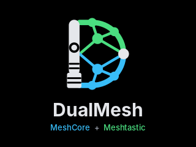

# DualMesh – one handheld, both mesh networks

**English** | [Dansk](README.da.md)

[](https://github.com/geekgarage/dualmesh/releases/latest)
[](LICENSE)



**DualMesh turns a LilyGo T-Deck Plus into a stand-alone off-grid communicator that talks
MeshCore *and* Meshtastic at the same time** – with a real keyboard, offline maps and GPS, and no
phone required.

**[Install in your browser](https://geekgarage.github.io/dualmesh/flash/)** ·
[Download](https://github.com/geekgarage/dualmesh/releases/latest) ·
[Report a bug](https://geekgarage.github.io/dualmesh/rapport/)

## Why DualMesh?

MeshCore and Meshtastic are the two big LoRa mesh networks, but they cannot talk to each other.
Normally you pick one, carry two radios, or reflash your device to switch. DualMesh removes that
choice.

- **Both networks on one radio.** A scheduler switches the single SX1262 between MeshCore and
  Meshtastic in milliseconds, so you can message people on either network from one device.
- **No phone needed.** Read and write messages, browse contacts and channels, see where people
  are on the map – all on the T-Deck's own keyboard, trackball and touch screen. Want your phone
  anyway? The official MeshCore app or Meshtastic app connects over Bluetooth.
- **Built for the outdoors.** Offline maps of whole countries, GPS tracks you can save as GPX,
  shared locations, geocaching and an SOS that alerts both networks at once.
- **Private by default.** Your position is never sent unless you turn it on, telemetry replies are
  off, and keys, passwords and identities are encrypted on the SD card.
- **Easy to install and keep current.** Install from the browser in a minute, then update over
  WiFi from the menu. No build tools, no command line.
- **Open source.** MIT licensed, written from scratch; the Meshtastic part is a clean-room
  implementation from the public protocol documentation.

## Features at a glance

| | |
| --- | --- |
| **Messaging** | MeshCore channels, DMs with delivery receipts, adverts and contacts · Meshtastic channels, encrypted (PKI) DMs with ACK, signed messages · @-mentions, emoji picker, drafts · message history per conversation on the SD card |
| **Maps & GPS** | Offline raster maps (download Denmark over WiFi or make your own) · your position and other nodes on the map · tracks (CSV/GPX) · share a location in any chat · Meshtastic waypoints · geocaching from GPX files or Opencaching |
| **Safety** | SOS: hold the trackball for 5 s to send your position on both networks until you stop it · position sharing off by default, per network, with an "approximate" (≈ 1 km) option |
| **Connectivity** | MeshCore app and Meshtastic app over Bluetooth · WiFi with NTP time · MQTT bridge (also TLS) to your own broker, e.g. for Home Assistant or Node-RED · Meshtastic relaying (optional) |
| **Device** | English and Danish UI (more languages can be added) · keyboard layouts with special characters (å, ä, ñ …) · screen dimming, CPU and GPS power saving · SD encryption · profile export/import · the SD card as a USB drive |
| **Updates** | Install from the browser · over-the-air updates from GitHub · downloadable keyboard layouts, languages and map packs · launcher friendly |

**Good to know**
- One radio means time-sharing: while it listens on one network it cannot hear the other, so a
  small share of packets can be missed compared with a single-network device. The scheduler is
  tuned to keep that low (simulated 2–10 % at moderate traffic).
- Hardware: LilyGo **T-Deck Plus** (ESP32-S3 with SX1262 and GPS). Always attach an antenna before
  using the radio.
- DualMesh is compatible with MeshCore and Meshtastic but is not affiliated with either project.
- Some features still wait for field testing (for example Meshtastic relaying with three or more
  nodes); see the status table below.

The project is developed in Danish: code comments, log lines and the design documents
(`docs/spec.md`, `CLAUDE.md`) are in Danish, while the user interface defaults to English.

## Status

| Area | Status |
| --- | --- |
| Radio and scheduler (CAD, self-calibration, LBT, shared 10 % duty cycle) | Runs on hardware |
| MeshCore: adverts, contacts, channels, DMs, telemetry | Receiving and sending tested in the field |
| Meshtastic: channels, NodeInfo, Position, PKI DMs, XEdDSA, telemetry, traceroute, waypoints | Tested against Meshtastic 2.8.2; relaying not yet tested with 3 nodes |
| User interface (LVGL), English and Danish | Everything is drawn with LVGL; language is chosen in Settings > System |
| MeshCore app and Meshtastic app over Bluetooth | Works (one app at a time, pairing with a PIN) |
| WiFi, NTP, GPS, SOS, SD encryption, profile export/import | Works |
| MQTT bridge (also TLS) | Tested both ways |
| Offline maps, tracks, shared locations, geocaching | Works; map packs can be downloaded over WiFi |
| Firmware updates (OTA), layouts and languages from GitHub | Releases are built by GitHub Actions |

The full requirements are in `docs/spec.md` and the detailed status in `CLAUDE.md` (Danish).

## Hardware

LilyGo T-Deck Plus: ESP32-S3 (16 MB flash, 8 MB PSRAM), SX1262, ST7789 320×240 with touch,
keyboard, trackball, microSD and u-blox GPS. Radio, display and SD card share one SPI bus; the
firmware sends to the display and SD card in small chunks, so the radio never waits long.

**Never transmit without an antenna attached.** Respect your region's power limit and duty
cycle (e.g. EU 869.4–869.65 MHz: 10 %, 27 dBm); the firmware enforces 10 % itself.

## Install

No build tools needed:

- **In the browser:** open the [flash page](https://geekgarage.github.io/dualmesh/flash/) in Chrome
  or Edge, connect the T-Deck Plus by USB and press *Install DualMesh*.
- **Update:** Settings > System > *Update firmware* installs the newest release over WiFi (the
  SHA-256 is checked before the new firmware is selected). Under a launcher, the firmware is saved to
  `/dualmesh/firmware/` on the SD card instead, for the launcher to install.
- **Launcher or esptool:** download the files from the
  [latest release](https://github.com/geekgarage/dualmesh/releases/latest); the release notes have
  the esptool command.

Over WiFi the T-Deck can also fetch keyboard layouts (Settings > Keyboard and trackball > *Get
layouts*), languages (Settings > System > *Get languages*) and map packs (Settings > Map > *Get map
packs*; Denmark is 1.58 GB, so use WiFi rather than mobile data). An interrupted map download
resumes where it stopped.

## Build and flash

Requires PlatformIO (env `tdeck_plus`, Arduino framework with ESP-IDF drivers).

```bash
pio run -e tdeck_plus                 # build
pio run -e tdeck_plus -t upload       # flash (T-Deck on USB)
pio device monitor -e tdeck_plus      # serial log, 115200
```

If the upload fails: hold the trackball down, press reset, release the trackball (boot mode)
and try again. Opening the COM port restarts the T-Deck.

**Releases:** raise `DM_FW_VERSION` in `src/version.h`, commit, and push a tag with the same
version (`git tag v0.1.1 && git push origin v0.1.1`). GitHub Actions
(`.github/workflows/release.yml`) builds the firmware, creates the release with `tools/release.py`
and puts the new firmware on the flash page. Map packs live in their own releases (`kort-N`,
created with `--latest=false`) and are listed in `maps/index.txt`.

## Usage

- **Tabs:** Channel | Contact | Map | Settings. The cursor starts in the list: up above the top
  row goes to the tab bar, where left/right chooses a tab and down/click goes in. In the list,
  right/click/Enter opens (a channel or contact opens the chat); left or Backspace goes back.
  Tapping the screen works too.
- **Chat:** just start typing, Enter sends. If you go back with text in the field, it is kept as
  a draft for that conversation. Your messages are on the right in green, others on the left
  with the sender in the contact's colour. DMs are shown as bubbles. Tap someone else's message
  in a channel to mention the sender (@-mention).
- **Emojis:** tap 😀 in front of the input field or press the Mic key; pick with the trackball or
  by touch. Colour emojis are also shown in received messages.
- **Special characters:** type a key that has variants (e.g. `a`) and pick å, æ, á … in the bar
  with the trackball. Layouts are in `keyboards/`.
- **Map:** offline maps from the SD card (see "SD card" below). The trackball or a finger moves
  the map; clicking the trackball centres on and follows your GPS position. `o` (+) zooms in and
  `i` (-) out, or use the buttons on the right. When the map is not following you, a thin red
  crosshair marks the point and its coordinates are shown at the top. Enter or ≡ opens the map
  menu.
- **Map menu:** share the crosshair's point (or your position) in a channel or DM, save it as a
  point on the map, send it as a Meshtastic waypoint, record tracks, and open saved tracks
  (`s`), geocaches (`g`) and map packs (`k`).
- **Shared locations:** a location is sent as text ("📍 55.67567, 12.56756"), so it works on both
  networks and in every app. Tap a received location in the chat to show or save it on the map.
  The chat's gear menu has "Share my position".
- **Meshtastic waypoints:** waypoints from others on your channels become magenta points; your
  own are sent on "Channel for data" (Settings > Meshtastic).
- **Tracks:** "Start track" in the map menu records where you have been (red line), also across
  a restart. "Saved tracks" shows a track on the map or deletes it. The files are CSV and GPX.
- **Geocaching:** caches from GPX files (Pocket Query from geocaching.com, opencaching.de) or
  fetched from Opencaching over WiFi (`o` in the list; needs your own free API key). The list
  shows the nearest caches with distance and bearing; details, hint, "Navigate here" (dashed
  line and distance on the map), found/not found and "Delete from list". `e` writes field notes
  (`geocache_visits.txt`) for upload.
- **SOS:** hold the trackball click for 5 s and confirm with Enter. Sends your position on both
  networks until it is stopped again. Not a replacement for emergency services (112/911).
- **Settings:** everything is under Settings, grouped by subject (WiFi, Bluetooth, GPS, Map,
  MeshCore, Meshtastic, MQTT, Screen …). Changes take effect after **Save**.
- **Language:** English by default; Danish is chosen under Settings > System > "Sprog /
  Language". More languages can be put on the SD card as `/dualmesh/lang/<id>.txt` (same
  format as `lang/en.txt`).
- **Privacy:** your own position is never shared unless you turn it on (per network), and
  telemetry replies are off by default.

## Text commands

There are three places where the T-Deck can be controlled with text. Everything else is in the
menus.

### Serial monitor (USB, 115200 baud)

`pio device monitor -e tdeck_plus` or any other terminal program. Note: opening the port
restarts the T-Deck. One character = one command; commands with text end with Enter, and an
empty line cancels. In passcode mode (SD encryption) only `s`, `p` and `h` work until the code
has been entered on the T-Deck. The log lines are in Danish.

| Key | Does |
| --- | --- |
| `h` | Help: lists all keys |
| `s` / `p` | Statistics now / the radio plan |
| `l` | All regions and presets (Meshtastic and MeshCore) |
| `m` | MeshCore status (node, contacts, messages) |
| `k` | Our Meshtastic channels |
| `a` | Send a MeshCore advert |
| `c` + text | Write to MeshCore #Public |
| `C` + `mc,name,key` / `mt,name,psk` | Add a channel (key in base64; empty = new/default) |
| `N` + name | Change the node name (and send an advert) |
| `=` + `key=value` | Set a setting as in the menu. Radio settings need a restart afterwards |
| `T` | Test message on/off in the last chosen conversation (DM or private channel only) |
| `J` | List the saved tracks |
| `G` | Test downloading from GitHub (keyboard catalogue and the latest `version.txt`) |
| `W` / `w` | Send / delete a test waypoint (only on the channel DMtest) |
| `I` | Report header: version, boot reason and latest crash |
| `d` / `D` | Send the 3 newest / all SD logs over USB (`tools/fetch_logs.py`) |
| `L` | Write the log to SD now |
| `M` / `P` / `X` | Self-test: message store / profile export / Meshtastic |
| `R` + `JA` | Reset DualMesh (deletes only `/dualmesh/` on the SD card) |
| `U` + `LAGER` | Restart with the SD card as a USB drive (see "SD card") |
| `F` + `FORMATER` | Format the SD card (deletes everything on the card) |

### MeshCore app (Bluetooth, the app's command line)

Works when the T-Deck is paired with the app (Settings > Bluetooth, App = MeshCore). The
replies follow MeshCore's own companion firmware, so the app's WiFi screen works.

| Command | Does |
| --- | --- |
| `get name` / `board` / `ver` / `clock` | Node name / device / firmware version / clock |
| `reboot` | Restart |
| `get wifi.status` / `get wifi.ip` | Connected or not / IP address |
| `get wifi.enabled` / `set wifi.enabled 0\|1` | WiFi off/on |
| `get wifi.ssid` / `set wifi.ssid <name>` | The network (set the password afterwards) |
| `get wifi.pwd` / `set wifi.pwd <password>` | Read the password / set it, connect and remember the network |
| `set wifi.clear` | Forget all saved WiFi networks |

Other commands answer "Unknown command" as in MeshCore. Passwords are never written to the log.

### MQTT bridge

Turned on under Settings > MQTT. `<root>` is the Topic root (default `dualmesh/<3 bytes of MAC>`),
`<net>` is `meshcore` or `meshtastic`, and channel names are URL-encoded (`#test` = `%23test`).

| Topic | Direction | Content |
| --- | --- | --- |
| `<root>/rx/<net>/chan/<channel>` | out | Received channel message (JSON with sender, text, hops, time, rssi, snr) |
| `<root>/rx/<net>/dm/<sender>` | out | Received DM (MeshCore: first 6 bytes of the key in hex, Meshtastic: `!nodeid`) |
| `<root>/tx/<net>/chan/<channel>` | in | Send text on the channel (only with "Send from MQTT"; plain text or `{"text":"..."}`) |
| `<root>/tx/<net>/dm/<recipient>` | in | Send a DM (name, key prefix in hex or `!nodeid`) |
| `<root>/result` | out | Answer to each tx: sent or rejected with a reason |
| `<root>/status` | out | Status (retained); `{"online":false}` when the T-Deck disappears |

Messages received before the bridge is connected (e.g. just after start-up) are kept (up to 16)
and published when the connection is up. Sending from MQTT is limited to one message per 10 s,
and the radio's shared 10 % limit applies.

## SD card

All DualMesh files live in `/dualmesh/` on the card: `settings.ini`, messages per conversation,
contacts, channels, log files and exported profiles. Without an SD card everything works, just
without saving. Internal NVS is only used by ESP-IDF itself (Bluetooth pairing, WiFi
calibration).

**The SD card as a USB drive:** Settings > System > "SD as USB drive" (click twice) or monitor
`U` + `LAGER`. The T-Deck restarts without radio and networks, and the card appears as a drive on
the PC, so files can be added without taking the card out (e.g. `/dualmesh/mqtt_ca.pem` or
`presets.txt`). Eject the drive on the PC and the T-Deck restarts normally (a trackball click
also works, but eject first or files may be lost). The serial port is gone while the drive is
connected.

**Maps, tracks and geocaches on the card:**

| Folder/file | Content |
| --- | --- |
| `/dualmesh/maps/*.pmtiles` | Map packs (raster tiles), made with `tools/maps/make_map.py` |
| `/dualmesh/maps/points.txt` | Saved points and Meshtastic waypoints |
| `/dualmesh/tracks/` | Tracks as `.csv` (while recording) and `.gpx` |
| `/dualmesh/caches/*.gpx` | Geocaches (your own GPX files and `opencaching.gpx`) |
| `/dualmesh/caches/found.txt` | Found/not found/deleted; `geocache_visits.txt` = field notes |

A map pack is made on a PC from OpenStreetMap data (Protomaps builds, only the bytes that are
needed), for example:

```bash
python tools/maps/make_map.py --bbox 8.0,54.5,15.25,57.8 --zoom 0-15 --name Danmark --cache cache_dk
```

Denmark at zoom 0-15 takes about 1.65 GB (keep packs under 2 GB). Copy it over with the USB
drive.

**New MeshCore presets without new firmware:** put a text file `/dualmesh/meshcore/presets.txt`
on the card with one preset per line (`#` = comment):

```
# title;frequency_hz;bw_hz;sf;cr[;path_hash_size[;deprecated 0/1]]
My area;869618000;62500;8;8;2
```

The same title as a built-in preset replaces it; new titles appear at the bottom of the list
under Settings > MeshCore > Preset. The file is read at start-up (`[RADIO] presets.txt: …` in
the log; at most 32 lines and 8 KB). Invalid lines are skipped.

## Encryption

### Secret files on the SD card

These files are encrypted with **AES-256-GCM** (encrypted and protected against tampering):

| File | Content |
| --- | --- |
| `meshcore/identity.txt` | The MeshCore identity (the private key) |
| `meshcore/channels.txt` | The MeshCore channel keys |
| `meshtastic/channels.txt` | The Meshtastic channel keys (PSK) |
| `wifi.txt` | Saved WiFi networks and their passwords |
| `mqtt.txt` | The password for the MQTT broker |
| `ble.txt` | The Bluetooth PIN for pairing with the MeshCore app |

The key is chosen under **Settings → System → SD encryption**:

| Mode | The key comes from | Protects against |
| --- | --- | --- |
| **off** | – (plain text) | Nothing |
| **chip ID** (default) | The chip's unique ID and MAC address (SHA-256) | A lost or copied SD card. Not against someone who has the T-Deck itself |
| **passcode** | A code you enter at every start-up (PBKDF2-HMAC-SHA256, 30,000 rounds, random salt) | Both a lost card and a lost T-Deck. Until the code is entered, MeshCore, channels, WiFi and Bluetooth do not start, and the USB monitor can only show statistics |
| **eFuse** | A secret key burned into the chip; the firmware can use it but not read it (HMAC) | A lost card; the key cannot be copied out of the chip. Burning a new key is **irreversible** and requires typing BRUG EFUSE |

- No key is stored on the SD card or in internal NVS. `crypto.txt` only holds the salt and a
  check value for passcode mode.
- When you change mode, all secret files are read with the old key and written with the new one.
- A file that cannot be decrypted (wrong code, another card or another T-Deck) is **never
  overwritten**. MeshCore then runs with a temporary identity until the problem is solved.
- Old unencrypted files are encrypted automatically at start-up, and the old version of a secret
  file is overwritten with zeros before it is deleted. The SD card's own wear levelling may
  still keep a copy elsewhere: if a secret has been stored unencrypted on the card, the safest
  is to change it (new identity, new passwords).
- The passcode is only as strong as it is long: an attacker with the SD card can try codes
  offline. Use at least 10–12 characters.

**Not encrypted:** `settings.ini`, the messages (`msgs/`), contacts, contact colours and the log
files. The log files contain, among other things, GPS positions and received messages, so be
careful who gets an SD card with logs.

### Profile export

**Settings → Profile → Export profile** collects identity, names, channels, contacts and WiFi
networks in one file (`/dualmesh/eksport/<name>-<date>.dmp`), encrypted with **AES-256-GCM** and
a password of at least 6 characters (key derived with PBKDF2-HMAC-SHA256, 30,000 rounds and a
random salt; older export files can still be imported). The file is verified before the old
device gets a new identity. On import the content is written with the SD encryption chosen on
the new device. The settings (`settings.ini`) are not included.

### Over the radio and Bluetooth

- **MeshCore:** channel messages are encrypted with the channel's key; DMs with a key only you
  and the recipient know (derived from your public keys). #Public and #hashtag channels have
  known keys and are effectively public.
- **Meshtastic:** encrypted with the channel's PSK. The default key (`AQ==`, e.g. on LongFast) is
  public, so anyone can read along.
- **Bluetooth (MeshCore app):** the connection requires pairing with a PIN (Settings →
  Bluetooth). The PIN is stored encrypted and only shown on the screen under Bluetooth status.
  The app can read the WiFi passwords, but only while the T-Deck is paired. The pairing keys are
  stored by ESP-IDF in the chip's internal NVS (not on the SD card).
- Passwords and PINs are never written to the log, and log files are never committed to git
  (`.gitignore`).

Log files (`/dualmesh/logs/NNNN.log`, one per start-up) can be fetched over USB:

```bash
python tools/fetch_logs.py COM5 logs/sd
```

## Bug reports

Settings > System > "Error report" shows a QR code that opens a pre-filled GitHub issue with only
the version, boot reason and crash addresses. To attach a log, use the
[bug report page](https://geekgarage.github.io/dualmesh/rapport/): it fetches the log over USB
(Chrome/Edge) or from the SD card and removes names, messages, positions, keys and addresses in
your browser before anything is shared.

## Folders

| Folder | Content |
| --- | --- |
| `src/main.cpp` | Start-up, radio task, statistics and the serial monitor |
| `src/hal/` | SX1262 driver (direct registers) and GPS |
| `src/net/` | MeshCore node, Meshtastic node, message store, WiFi, BLE, MQTT, Opencaching |
| `src/map/` | Maps: PMTiles reader, PNG decoder, points, tracks and geocaches |
| `lang/` | Language files (`en.txt`); Danish is the source language (`tools/gen_lang.py`) |
| `src/storage/` | SD card (settings, log, encryption, profile, own write driver), NVS tool |
| `src/ui/` | User interface (LVGL), input, display driver; `src/ui/lv/fonts/` holds generated fonts |
| `lib/dualmesh/src/` | Hardware-independent core: scheduler, LoRa timing, presets for both networks |
| `lib/meshcore/`, `lib/ed25519/` | Locked copy of the MeshCore files in use (updated with `tools/sync_meshcore.py`) |
| `host/` | Simulator and tests that run on a PC (CMake + Ninja) |
| `tools/` | Generators (fonts, emojis, keyboard layouts, languages), map packs (`tools/maps/`) and log fetching |
| `assets/logo/` | The DualMesh logo (SVG, PNG, firmware headers) |
| `fonts/` | Source fonts with licenses |
| `docs/rapport/`, `docs/flash/` | The bug report page and the flash page (GitHub Pages) |
| `.github/workflows/` | Release build (tag `v*`) and GitHub Pages |
| `keyboards/`, `lang/`, `maps/` | Catalogues (`index.txt`) the T-Deck downloads from |

Simulator and tests on a PC:

```bash
cmake -S host -B build -G Ninja -DCMAKE_CXX_COMPILER=g++ && cmake --build build && ./build/sim && ./build/test_phy && ./build/test_i18n
```

## Licenses and thanks

DualMesh is MIT. The full list of licenses is in `THIRD_PARTY_NOTICES.md`. It builds on:

- [MeshCore](https://github.com/meshcore-dev/MeshCore) (MIT) – selected files in `lib/meshcore/`
- ed25519 by Orson Peters (zlib) – `lib/ed25519/`
- [LVGL](https://lvgl.io) 8.4 (MIT)
- rweather/Crypto (MIT) and densaugeo/base64 (MIT)
- Fonts under the SIL Open Font License 1.1: Montserrat, JetBrains Mono, Noto Emoji and
  Noto Color Emoji (the licenses are in `fonts/*/OFL.txt`)

Map data: © OpenStreetMap contributors (ODbL, openstreetmap.org/copyright) and Natural Earth
(public domain), via Protomaps builds; the tiles are drawn by DualMesh itself and are never
fetched from OpenStreetMap's own tile servers. Geocaches from Opencaching via their open API
(OKAPI) with the user's own key.

The Meshtastic part is written from the public protocol documentation; no code, `.proto` files
or generated code from the Meshtastic project (GPL-3.0) are used.
